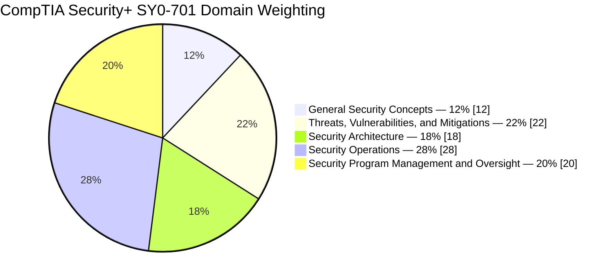
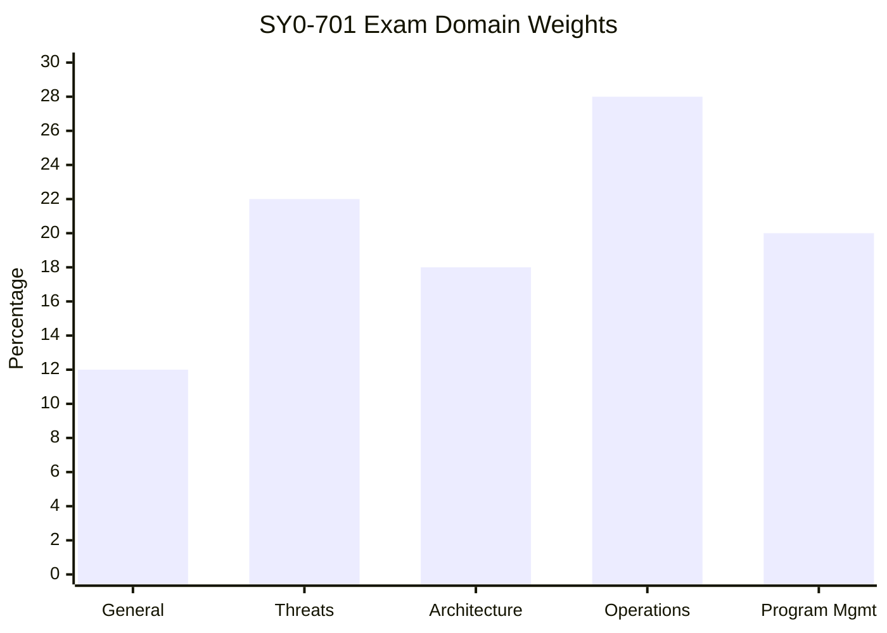
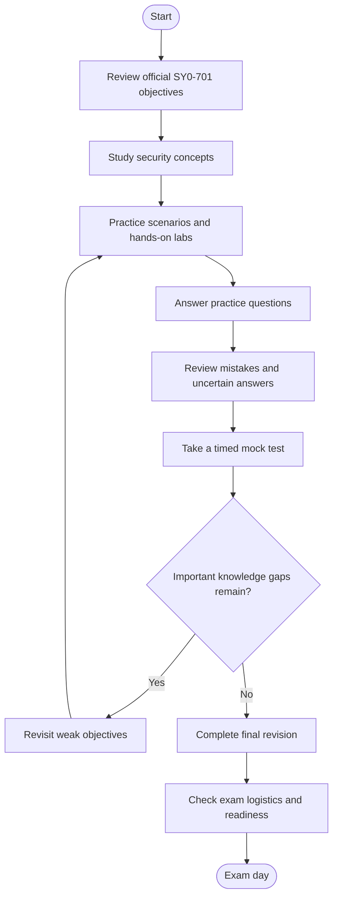
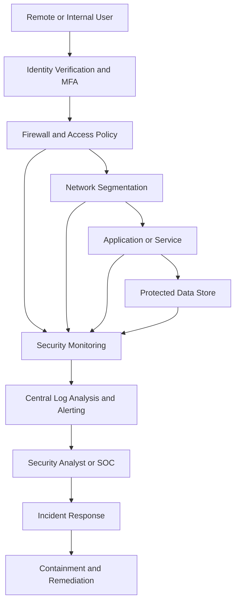
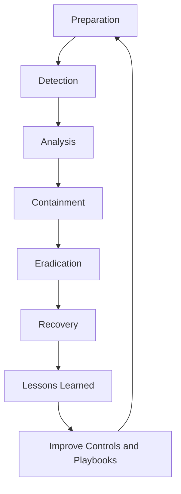
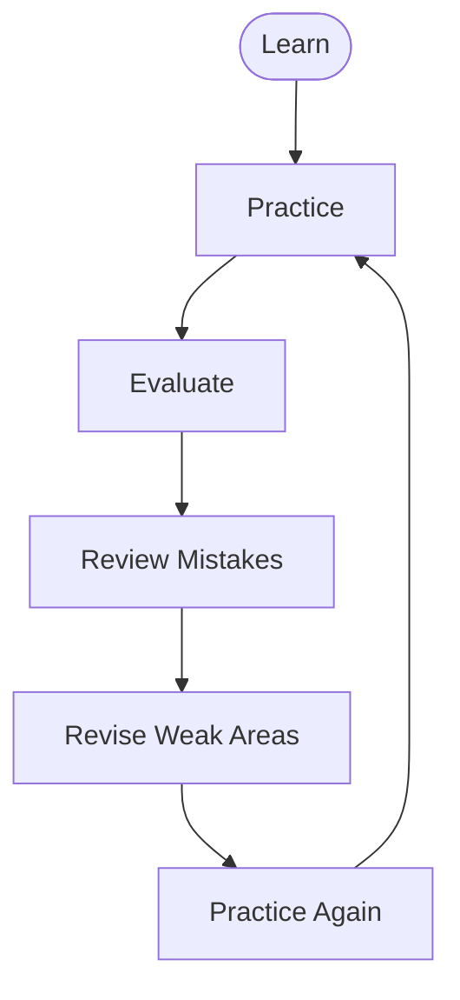
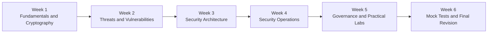

# CompTIA Security+ SY0-701 Study Guide

A practical, exam-focused guide to preparing for **CompTIA Security+ SY0-701**, covering security fundamentals, threats and vulnerabilities, security architecture, security operations, incident response, and security program management.

This repository combines the exam objectives with a structured study plan, security architecture diagrams, original practice questions, hands-on lab ideas, and a repeatable revision process. It is intended to help learners understand how security controls work, recognize common attack scenarios, and select appropriate defensive measures.

- **Certification:** CompTIA Security+
- **Exam code:** SY0-701
- **Exam version:** V7
- **Exam duration:** 90 minutes
- **Maximum questions:** 90
- **Question types:** Multiple-choice and performance-based
- **Passing score:** 750 on a scale of 100–900
- **Official objectives:** [CompTIA Security+ SY0-701 Exam Objectives](https://www.comptia.org/en-us/resources/exam-objectives)

---

## Table of Contents

- [About CompTIA Security+](#about-comptia-security)
- [Who Should Prepare for SY0-701?](#who-should-prepare-for-sy0-701)
- [Exam Information](#exam-information)
- [Skills Covered by Security+](#skills-covered-by-security)
- [Official Exam Objectives](#official-exam-objectives)
- [Exam Domain Weightage](#exam-domain-weightage)
- [Security+ Preparation Flowchart](#security-preparation-flowchart)
- [Security Architecture Diagram](#security-architecture-diagram)
- [Incident Response Workflow](#incident-response-workflow)
- [Circular Study and Revision Cycle](#circular-study-and-revision-cycle)
- [Step-by-Step Preparation Guide](#step-by-step-preparation-guide)
- [Six-Week Study Roadmap](#six-week-study-roadmap)
- [Practice Questions and Mock Tests](#practice-questions-and-mock-tests)
- [Hands-On Security Labs](#hands-on-security-labs)
- [Common Preparation Mistakes](#common-preparation-mistakes)
- [Certification Benefits and Career Relevance](#certification-benefits-and-career-relevance)
- [Frequently Asked Questions](#frequently-asked-questions)
- [Official and Additional Learning Resources](#official-and-additional-learning-resources)
- [About CertsGate](#about-certsgate)

---

## About CompTIA Security+

CompTIA Security+ is a cybersecurity certification focused on foundational security knowledge and practical defensive skills. The SY0-701 exam evaluates a broad range of subjects, from fundamental security controls and cryptography to threat analysis, secure infrastructure, incident response, and governance.

The certification is relevant to people who want to develop a structured understanding of how organizations protect systems, networks, applications, and information. It also provides a useful framework for reviewing security concepts that are often encountered in IT administration, security operations, and technical support roles.

Security+ preparation should involve more than memorizing terminology. A scenario may describe an exposed service, a suspicious login, a vulnerable application, or a failed recovery process and ask which action best addresses the underlying risk.

The objective is to understand **why a control is appropriate, where it should be applied, and what problem it is intended to solve**.

This repository uses the published SY0-701 domains as its organizing structure. Its diagrams, study schedules, lab suggestions, and sample questions are independent learning aids.

## Who Should Prepare for SY0-701?

This study guide may be useful for:

- IT support professionals moving toward security responsibilities.
- Network and systems administrators who want to strengthen defensive skills.
- Aspiring security operations center (SOC) analysts.
- Learners studying vulnerability management and incident response.
- Junior cybersecurity professionals reviewing core security concepts.
- Students preparing for an entry-level cybersecurity certification.

CompTIA's SY0-701 objectives recommend a minimum of two years of IT administration experience with a focus on security, hands-on technical information security experience, and broad knowledge of security concepts. Treat this as recommended background, not as a claim that every learner must follow the same career path.

If you are new to IT, build a foundation in networking, operating systems, authentication, and basic troubleshooting before progressing to more complex security scenarios.

## Exam Information

| Item | SY0-701 details |
|---|---|
| Certification | CompTIA Security+ |
| Exam code | SY0-701 |
| Version label | V7 |
| Duration | 90 minutes |
| Maximum number of questions | 90 |
| Question formats | Multiple-choice and performance-based |
| Passing score | 750 on a 100–900 scale |
| Recommended background | IT administration experience focused on security and broad security knowledge |
| Official exam objectives | CompTIA Security+ SY0-701 objectives |

The passing score is a scaled score, not a percentage of questions answered correctly. Do not convert 750 out of 900 into a target percentage or assume that every exam form contains the same mix of scored items.

For current exam availability, registration options, policies, and any version-transition information, consult [CompTIA Security+](https://www.comptia.org/en-us/certifications/security).

---

## Skills Covered by Security+

The SY0-701 exam connects several important areas of cybersecurity.

| Skill area | What to understand |
|---|---|
| Security fundamentals | Confidentiality, integrity, availability, authentication, authorization, and security controls |
| Threat analysis | Threat actors, attack vectors, vulnerabilities, malware, social engineering, and indicators of compromise |
| Security architecture | Segmentation, cloud security, secure network design, resilience, and secure communication |
| Security operations | Hardening, identity and access management, monitoring, vulnerability management, and incident handling |
| Cryptography | Encryption, hashing, digital signatures, certificates, public key infrastructure, and key management |
| Governance and risk | Policies, standards, risk assessment, compliance, audits, third-party risk, and security awareness |
| Recovery and resilience | Backups, disaster recovery, business continuity, redundancy, and recovery testing |

A useful way to approach these topics is to connect each concept to a practical question:

- What risk does this control reduce?
- What evidence would indicate that a problem exists?
- Where should the control be placed?
- What are the operational trade-offs?
- How can the organization verify that the control works?

These questions encourage the kind of applied understanding needed for scenario-based security problems.

## Official Exam Objectives

The SY0-701 blueprint contains five domains. The descriptions below summarize the main areas to study; use the official objective document for the full list of subtopics.

### Domain 1.0 — General Security Concepts (12%)

Study the foundations used throughout the rest of the exam:

- Technical, managerial, operational, and physical security controls.
- Preventive, deterrent, detective, corrective, compensating, and directive controls.
- Confidentiality, integrity, and availability (CIA).
- Authentication, authorization, and accounting (AAA).
- Zero Trust concepts and physical security.
- Change management and documentation.
- Cryptographic solutions, including encryption, hashing, salting, certificates, digital signatures, and public key infrastructure.

**Study approach:** Learn to distinguish concepts that sound similar. For example, encryption protects confidentiality, while hashing is commonly used to verify data integrity or support password verification. They are not interchangeable.

### Domain 2.0 — Threats, Vulnerabilities, and Mitigations (22%)

Study:

- Threat actors, motivations, and capabilities.
- Threat vectors and attack surfaces.
- Vulnerabilities in applications, operating systems, cloud environments, hardware, and supply chains.
- Malware, social engineering, network attacks, application attacks, and password attacks.
- Indicators of malicious activity.
- Mitigation techniques, including patching, segmentation, isolation, encryption, least privilege, and hardening.

**Study approach:** Connect an attack path to the weakness it exploits and the control that best interrupts that path. Learn to distinguish a threat actor, an attack vector, a vulnerability, an exploit, and a mitigation.

### Domain 3.0 — Security Architecture (18%)

Study:

- Cloud, on-premises, hybrid, and distributed architectures.
- Virtualization, containers, microservices, serverless computing, and infrastructure as code.
- Network segmentation and security zones.
- Firewalls, intrusion detection and prevention systems, proxies, and secure remote access.
- High availability, redundancy, disaster recovery, and continuity planning.
- Secure infrastructure for IoT and industrial control environments.

**Study approach:** Understand the placement and purpose of each control. A network firewall, a web application firewall, and endpoint protection address different layers of risk.

### Domain 4.0 — Security Operations (28%)

This is the largest published domain in the SY0-701 blueprint.

Study:

- Secure configuration baselines and system hardening.
- Asset inventory and data protection.
- Identity and access management, multifactor authentication, and privileged access.
- Vulnerability management and remediation.
- Endpoint, network, application, and cloud monitoring.
- Log analysis, alerts, and investigative data sources.
- Security automation and orchestration.
- Incident response, containment, eradication, recovery, and lessons learned.
- Backup and restoration procedures.

**Study approach:** Practice interpreting situations and choosing the next appropriate action. For example, distinguish an alert that needs investigation from a confirmed incident that requires containment.

### Domain 5.0 — Security Program Management and Oversight (20%)

Study:

- Security governance, policies, standards, procedures, and guidelines.
- Risk identification, analysis, treatment, and monitoring.
- Business impact analysis and continuity planning.
- Third-party risk and supply chain considerations.
- Compliance, audits, assessments, and security testing.
- Privacy, data handling, retention, and regulatory considerations.
- Security awareness, phishing prevention, and user education.

**Study approach:** Understand the difference between a policy that sets requirements, a procedure that describes steps, and a technical control that enforces or supports those requirements.

**Official source:** [CompTIA Security+ exam objectives](https://www.comptia.org/en-us/resources/exam-objectives).

---

## Exam Domain Weightage

The following chart values reproduce the published SY0-701 domain percentages.

### Official domain distribution

### Domain comparison

Security Operations has the largest allocation at 28%, followed by Threats, Vulnerabilities, and Mitigations at 22%. Security Program Management and Oversight accounts for 20%, Security Architecture 18%, and General Security Concepts 12%.

Use these percentages to guide your initial study plan. They do not guarantee an exact number of questions from each domain on an individual exam form.

---

## Security+ Preparation Flowchart

Preparation should be a continuous process of learning, applying, testing, and reviewing. If a practice session exposes an important gap, return to the relevant objective instead of simply completing more questions.

This is an independent preparation workflow, not an official CompTIA process.

## Security Architecture Diagram

A security environment uses multiple layers of protection. The following conceptual diagram shows how traffic and identity checks can work together in a simplified enterprise network.

### How to interpret the diagram

- **Identity verification:** Confirms the identity of a user or system before granting access.
- **Firewall and access policy:** Restricts communication according to approved rules.
- **Segmentation:** Limits unnecessary communication between network areas.
- **Protected services and data:** Apply appropriate application, endpoint, and data security controls.
- **Monitoring:** Collects logs and events that can help detect suspicious activity.
- **Incident response:** Investigates and responds when evidence indicates a security problem.

Real deployments vary. This diagram illustrates general defensive principles and is not a required CompTIA architecture.

### Security control comparison

| Control | Main purpose | Example |
|---|---|---|
| Firewall | Filter network traffic | Block unauthorized inbound connections |
| IDS | Detect suspicious activity | Alert on a potential attack pattern |
| IPS | Detect and block selected malicious traffic | Prevent a recognized malicious connection |
| WAF | Protect web applications from selected application-layer attacks | Filter malicious HTTP requests |
| EDR | Monitor endpoint behavior and support response | Investigate suspicious process activity |
| SIEM | Aggregate and correlate security events | Link authentication anomalies with endpoint alerts |
| MFA | Require multiple authentication factors | Password plus a security key |

These controls can complement one another, but none should be assumed to prevent every type of attack.

---

## Incident Response Workflow

Incident response is a practical area of security operations. Learn the purpose of each stage and understand that responders may need to revisit earlier steps as new evidence appears.

For study purposes, consider a workstation that begins making suspicious outbound connections.

1. **Preparation:** Ensure logging, response procedures, access controls, and backups are in place.
2. **Detection:** Review endpoint alerts, network telemetry, and relevant logs.
3. **Analysis:** Determine whether the activity is malicious and assess its scope.
4. **Containment:** Limit further damage, such as isolating an affected device when appropriate.
5. **Eradication:** Remove the cause of the incident and address the exploited weakness.
6. **Recovery:** Restore systems safely and monitor for recurring activity.
7. **Lessons learned:** Document findings and improve procedures or controls.

The exact actions depend on the scenario, evidence, business impact, and incident response policy.

## Circular Study and Revision Cycle

Security+ preparation is more effective when practice results lead to targeted revision.

After each study session:

1. Record the topic you studied.
2. Answer questions without relying on notes.
3. Explain why each selected answer is appropriate.
4. Review incorrect answers and uncertain guesses.
5. Revisit the related official objective.
6. Test yourself again with a different scenario.

A correct guess is not necessarily mastery. Make sure you can explain why the best answer fits and why the alternatives are less appropriate.

---

## Step-by-Step Preparation Guide

### Step 1: Build an objective checklist

Download the official SY0-701 exam objectives and convert each objective into a checklist. Mark items as not started, in progress, or ready for review.

This gives your preparation a clear structure and helps prevent familiar topics from taking up all your time.

### Step 2: Learn security fundamentals

Begin with the CIA triad, AAA, access control models, security control types, change management, and cryptography.

Practice comparing concepts. For example:

- Authentication verifies identity.
- Authorization determines permitted actions.
- Accounting records relevant activity.
- Hashing produces a digest; encryption protects data confidentiality.
- A preventive control aims to stop an event, while a detective control identifies that an event may have occurred.

### Step 3: Study threats and vulnerabilities

Create a table of common attack types, indicators, and appropriate mitigations.

For each scenario, ask:

- What asset is at risk?
- What is the likely threat or attack vector?
- Which vulnerability or weakness is involved?
- What evidence supports the assessment?
- Which mitigation addresses the problem most directly?

This helps you move from memorization to applied reasoning.

### Step 4: Understand secure architecture

Review network segmentation, firewalls, secure remote access, cloud responsibility, secure protocols, redundancy, and recovery planning.

Use simple diagrams to show where a control sits and which traffic or activity it affects. Be able to explain the trade-offs between different approaches.

### Step 5: Prioritize security operations practice

Study hardening, endpoint protection, access management, logging, vulnerability handling, and incident response.

Practice reading sample logs and deciding which additional evidence you need. Avoid jumping to a conclusion based on a single unexplained alert.

### Step 6: Review governance and risk

Learn how policies, standards, procedures, risk assessments, audits, and compliance requirements fit together.

Practice scenarios where a technical control is available but must be selected according to risk, business requirements, data sensitivity, or an established policy.

### Step 7: Use practice questions carefully

Complete practice questions after studying the relevant material. Review all uncertain answers, not only the questions you got wrong.

Map each mistake to an exam objective and revise the underlying concept before taking another test.

### Step 8: Conduct a readiness review

Use a timed practice session to assess your pacing and identify gaps. Revisit any objectives that remain difficult to explain.

Before exam day, confirm the current exam code, policies, scheduling details, and identification requirements using official CompTIA information.

---

## Six-Week Study Roadmap

The following is an illustrative six-week schedule, not an official CompTIA requirement. Adjust it to your existing experience and available study time.

| Week | Focus | Suggested activities |
|---|---|---|
| 1 | General Security Concepts | Study the CIA triad, AAA, control types, cryptography, and change management |
| 2 | Threats, Vulnerabilities, and Mitigations | Compare attack vectors, malware, vulnerabilities, indicators, and mitigations |
| 3 | Security Architecture | Diagram segmentation, cloud models, secure communication, and resilience |
| 4 | Security Operations | Practice log analysis, hardening, access management, vulnerability handling, and response workflows |
| 5 | Program Management and practical work | Review risk, governance, third-party risk, awareness, and complete selected labs |
| 6 | Assessment and revision | Take timed practice sessions, analyze weak objectives, and revisit difficult concepts |

If a domain is already strong, spend less time reviewing basic definitions and more time on complex scenarios. If a topic remains weak, repeat the relevant lab or explanation before progressing.

---

## Practice Questions and Mock Tests

The following questions are original educational examples created for this repository. They are not actual, leaked, or official CompTIA exam questions.

### Question 1: Security controls

An organization installs a monitoring system that generates an alert when suspicious network activity is detected. Which type of control best describes the primary function of the alerting system?

A. Preventive  
B. Detective  
C. Corrective  
D. Directive

**Answer: B — Detective**

**Explanation:** A detective control identifies or alerts on activity that may indicate a security issue. The alert itself does not necessarily prevent the activity or remediate its cause.

### Question 2: Identity and access

An employee needs to sign in to a sensitive business application. The organization requires a password and a hardware security key. Which security measure is being applied?

A. Multifactor authentication  
B. Network segmentation  
C. Data masking  
D. Change management

**Answer: A — Multifactor authentication**

**Explanation:** A password is something the user knows, while a hardware security key is something the user has. Using different authentication factor types provides multifactor authentication.

### Question 3: Vulnerability mitigation

A public-facing server is running an application version affected by a known security vulnerability. The vendor has released a verified patch. Which action most directly addresses the known software weakness?

A. Increase password length for unrelated user accounts  
B. Apply and validate the appropriate patch through change management  
C. Disable security logging  
D. Add more storage to the server

**Answer: B — Apply and validate the patch**

**Explanation:** A suitable patch addresses the known software vulnerability. Change control and testing help reduce the risk of introducing operational problems.

### Question 4: Incident response

An endpoint alert indicates that a workstation may be communicating with a malicious host. The incident has not yet been fully investigated. What is the best general next step?

A. Immediately delete every log from the device  
B. Ignore the alert until the user reports a problem  
C. Investigate the evidence and follow the incident response process, including containment when justified  
D. Assume the alert proves that all company systems are compromised

**Answer: C — Investigate and follow the response process**

**Explanation:** Responders should examine the available evidence, assess the scope, and take proportionate action according to established procedures. An alert should neither be ignored nor treated as proof of a broader compromise without investigation.

### Question 5: Risk management

A business identifies a risk that a critical service may become unavailable. The team documents the likelihood, potential impact, and possible mitigation options before deciding how to proceed. Which process is being performed?

A. Risk assessment  
B. Data destruction  
C. Password rotation  
D. Certificate renewal

**Answer: A — Risk assessment**

**Explanation:** Risk assessment examines the nature, likelihood, and impact of risks to help the organization decide on an appropriate treatment.

### How to use a mock test

A mock test is useful only when its results guide further study.

1. Complete a practice set without looking up answers.
2. Record incorrect answers and uncertain guesses.
3. Identify the related domain and objective.
4. Explain why the correct answer is the best fit for the scenario.
5. Review the relevant material or perform a practical exercise.
6. Take another set of questions to check whether the concept has improved.

Do not judge readiness by a single score alone. Consider whether you can explain concepts, apply controls to new scenarios, and understand why plausible alternatives are less suitable.

---

## Hands-On Security Labs

Hands-on work helps connect security terminology to practical decisions. Use systems and datasets you own or have explicit permission to test. Avoid testing against real third-party systems without authorization.

### Lab 1: Build a security control matrix

Create a table with assets, threats, vulnerabilities, existing controls, and proposed mitigations.

Example:

| Asset | Potential risk | Example control | Validation method |
|---|---|---|---|
| User account | Credential theft | MFA and least privilege | Review authentication and access settings |
| Public web service | Exploitation of a known vulnerability | Patching and secure configuration | Verify patch level and run an authorized scan |
| Sensitive file | Unauthorized disclosure | Access restrictions and encryption | Test access permissions and encryption settings |
| Workstation | Malicious process activity | Endpoint monitoring | Review sample alerts and event logs |

The goal is to match controls to risks and define how their effectiveness can be checked.

### Lab 2: Review authentication logs

Use sample or synthetic authentication logs to identify:

- Repeated failed logins.
- Unexpected privileged account activity.
- Logins at unusual times.
- Possible impossible-travel patterns.
- Successful logins following a burst of failures.

Write down what each indicator might mean, what alternative explanations exist, and what additional evidence you would examine before declaring an incident.

### Lab 3: Create a secure configuration checklist

Choose a lab virtual machine or an isolated test environment. Build a checklist for:

- Removing unnecessary services.
- Applying updates.
- Enabling host-based firewall rules.
- Reviewing default accounts and credentials.
- Applying least privilege.
- Enabling appropriate logging.
- Documenting configuration changes.

Record the initial state, the changes made, and the validation results.

### Lab 4: Practice network segmentation

Draw a small network containing user devices, a public-facing application, an internal application, and a database.

Define which systems need to communicate and which connections should be blocked. Explain how a firewall or access control rule can enforce the intended boundaries.

Keep the design simple enough that every permitted and denied connection has a clear reason.

### Lab 5: Work through a vulnerability management scenario

Using a lab asset inventory and authorized scan results:

1. Identify vulnerable systems.
2. Review severity and business context.
3. Determine whether the vulnerability is exploitable in the current environment.
4. Prioritize remediation.
5. Apply a patch or compensating control in the lab.
6. Verify the result and document any remaining risk.

A vulnerability score is useful evidence, but prioritization should also consider asset importance, exposure, available mitigations, and operational impact.

### Lab 6: Write an incident response playbook

Create a short playbook for a suspected compromised workstation. Include:

- Alert intake and initial validation.
- Evidence collection.
- Escalation criteria.
- Containment decisions.
- Eradication and recovery steps.
- Communication responsibilities.
- Lessons learned and control improvements.

Make the sequence clear enough that another authorized team member could follow it.

### Capstone project: Small enterprise security review

Create a conceptual security review for a fictional small business.

Include:

- An asset inventory.
- A simple network diagram.
- A threat and vulnerability table.
- Identity and access recommendations.
- A logging and monitoring plan.
- A basic incident response workflow.
- Backup and recovery considerations.
- A risk register with proposed treatments.

The final document should explain why each recommendation is relevant and how the organization could verify its effectiveness.

---

## Common Preparation Mistakes

### Memorizing definitions without understanding scenarios

Security+ questions may require you to apply a concept in context. Learn how to select an appropriate control rather than memorizing a list of terms.

### Confusing similar technologies

Understand the differences between IDS and IPS, encryption and hashing, authentication and authorization, and policies and procedures.

### Ignoring Security Operations

Security Operations has the largest published domain weighting. Allocate enough time to monitoring, access control, hardening, vulnerability management, automation, and incident response.

### Treating every alert as a confirmed incident

Alerts require investigation. Learn how to evaluate indicators, correlate evidence, and follow a response process.

### Studying only theory

Perform practical exercises involving logs, system hardening, network segmentation, and incident response. Practical work can reveal gaps that flashcards do not.

### Skipping governance and risk

Technical controls operate within business, legal, and operational constraints. Review policies, risk treatment, compliance, audits, and third-party risk.

### Relying on recalled or unauthorized exam content

Use legitimate preparation materials and original practice questions. CompTIA warns against unauthorized exam content, including brain dumps. Focus on understanding the objectives rather than attempting to memorize protected exam questions.

### Forgetting to check the exam version

Before committing to a long study plan or buying a voucher, verify the current exam code and objectives through CompTIA. Preparation materials for an older version may not align with a newer blueprint.

---

## Certification Benefits and Career Relevance

Security+ provides a structured way to learn and demonstrate foundational cybersecurity knowledge. The topics can be relevant to roles and responsibilities involving:

- Security operations and monitoring.
- IT support and systems administration.
- Vulnerability management.
- Incident response.
- Network and infrastructure security.
- Access control and identity management.
- Risk, compliance, and security awareness.

The certification alone does not guarantee a particular role, salary, or career outcome. Employers also consider practical experience, technical ability, communication, and the requirements of the specific position.

A documented lab portfolio can complement preparation by showing how you investigate logs, assess vulnerabilities, design access controls, and communicate security recommendations.

## Frequently Asked Questions

### What is CompTIA Security+ SY0-701?

SY0-701 is the exam code for the CompTIA Security+ V7 exam. Its published blueprint covers five domains: General Security Concepts; Threats, Vulnerabilities, and Mitigations; Security Architecture; Security Operations; and Security Program Management and Oversight.

### How long is the SY0-701 exam?

The published exam duration is 90 minutes.

### How many questions are on the exam?

The published maximum is 90 questions. The exam includes multiple-choice and performance-based questions.

### What is the passing score for Security+ SY0-701?

The published passing score is 750 on a scale of 100–900. This is a scaled score, not a direct percentage of correct answers.

### Which domain has the highest weighting?

Security Operations has the largest published weighting at 28%. Use the official objective document to plan your preparation across all five domains.

### Is hands-on experience useful for Security+ preparation?

Yes. Practical work can help you understand configuration, logging, vulnerability management, access control, and incident response. Use authorized lab environments and relate each activity to the official objectives.

### Are the sample questions in this repository official CompTIA questions?

No. They are original educational questions written to illustrate concepts and scenario-based reasoning. They are not actual, leaked, or official exam questions.

### Can practice questions replace the official objectives?

No. Use the official objectives to define the scope of your study. Practice questions can help identify gaps, while documentation and labs help you address them.

### How long should I study for SY0-701?

The required preparation time varies with your experience and current knowledge. The six-week roadmap in this repository is an example, not an official CompTIA recommendation. Adjust it according to your progress and areas of weakness.

### Where should I verify exam availability and updates?

Start with the [official CompTIA Security+ certification page](https://www.comptia.org/en-us/certifications/security) and the [official exam objectives resources](https://www.comptia.org/en-us/resources/exam-objectives).

---

## Official and Additional Learning Resources

Use the certification provider's documentation as the primary reference for exam requirements and objectives.

### Official CompTIA resources

- [CompTIA Security+ certification page](https://www.comptia.org/en-us/certifications/security) — certification information and current exam details.
- [CompTIA exam objectives resources](https://www.comptia.org/en-us/resources/exam-objectives) — official exam objective documents.
- [CompTIA certification exam policies](https://www.comptia.org/en-us/resources/test-policies) — review current testing and candidate policies.
- [CompTIA CertMaster learning products](https://www.comptia.org/en-us/training) — explore official training and learning options.

### Additional learning resources

- [CertsGate](https://certsgate.com/) — explore independent IT certification preparation materials.
- [NIST Cybersecurity Framework](https://www.nist.gov/cyberframework) — learn about cybersecurity risk management and organizational outcomes.
- [CISA](https://www.cisa.gov/) — access cybersecurity guidance, advisories, and defensive resources.
- [OWASP](https://owasp.org/) — explore application security resources and common web application risks.
- [Mermaid Live Editor](https://mermaid.live/) — preview and validate the diagrams in this README.
- [GitHub Markdown documentation](https://docs.github.com/en/get-started/writing-on-github) — learn how to format and maintain repository documentation.

These resources serve different purposes. The official CompTIA blueprint defines the exam scope; additional security references can help deepen your understanding of the underlying technologies and practices.

---

## About CertsGate

[CertsGate](https://certsgate.com/) is an independent IT certification preparation resource. Learners can explore its catalog for relevant study guides, practice questions, mock-test-style exercises, and other learning materials.

For SY0-701 preparation, use any relevant CertsGate content as a supplement to the official CompTIA objectives and your practical study. Review explanations, identify weak areas, and verify important technical details against reliable documentation.
